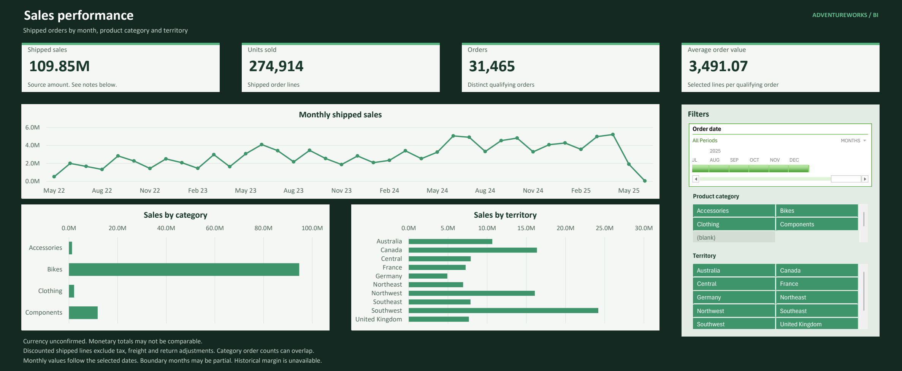
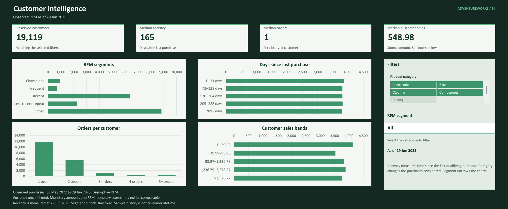

# AdventureWorks — Excel Business Intelligence

**Status: In development.** Sales and customer dashboards, validated shipped-sales metrics and a scenario worksheet are implemented locally. Portfolio documentation and release review are in progress. See [Current State](docs/CURRENT_STATE.md) for verified progress and limitations.

AdventureWorks — Excel Business Intelligence is a portfolio project that turns **Microsoft AdventureWorks OLTP** sample data into a commercial analysis workbook in **Excel 365 Desktop**. Power Query prepares the data, the Excel Data Model connects the commercial tables, and interactive views bring sales, customers, products, territories and scenarios together.

The distinction from ProcureFlow is intentional: **commercial intelligence and dimensional modeling**, not procurement, replenishment, or VBA-heavy operations.

For project context and task-specific reading guidance, see [REPO_CONTEXT.md](REPO_CONTEXT.md).

## Explore the dashboards

**Sales performance** shows shipped line sales, units, distinct orders and average order value, with a monthly trend and product-category and territory comparisons. Use the date, category and territory filters to explore a selection.

**Customer intelligence** groups observed customers into descriptive RFM segments. It shows customer counts and median recency, orders and customer sales, with distributions for recency, order frequency and monetary bands. Filter by product category and RFM segment.

The images are static, unfiltered Excel exports of the sample. Open the workbook to use the controls. `SalesScenario`, the third visible tab, explores price and discount assumptions at fixed volume; it is an arithmetic sensitivity, not a demand forecast.

## How it works

Seven selected source files feed Power Query and the Data Model. Relationships, measures and PivotTables support the dashboards and scenario. The [architecture](docs/ARCHITECTURE.md) and [source map](docs/SOURCE_MAP.md) describe the model and source grain. Codex, the Excel MCP and native Excel automation assisted implementation and verification; Jira tracks project work. The [AI workflow](docs/AI_WORKFLOW.md) records tested tool coverage and limitations.

| Technology | Role |
| --- | --- |
| Excel 365 Desktop, Power Query, Power Pivot | Data preparation, analytical model and interactive workbook |
| Codex with Terra (Medium / High / Extra High) | Development, analysis, review and tool coordination |
| User's Excel MCP for Codex | Direct Excel actions within verified capabilities |
| ChatGPT for Excel | Supported formula, sheet, formatting and chart work |
| Jira | Lightweight planning and task tracking |
| GitHub | Versioned artifacts, documentation and implementation evidence |

## Project plan

The project follows four phases: **data design**, **ingestion and modeling**, **AI-assisted analytics and dashboards**, and **validation and publication**. The original estimate of **8–12 working days (approximately 24–48 hours)** was a planning estimate. See the [Roadmap](docs/ROADMAP.md) for the current phase.

The exact scope is deliberately smaller than the full OLTP database. No historical performance claims or profit figures are published before validating their underlying data.

## Open and refresh the workbook

1. Open [AdventureWorks-BI.xlsx](AdventureWorks-BI.xlsx) in Excel 365 Desktop. The loaded sample is included; no source download is needed to inspect it.
2. Start with `DashboardSales` or `DashboardCustomers`. Choose a filter and clear it to return to the full view. On the customer dashboard, select the cell under **RFM segment** to choose a segment.
3. To refresh, follow the [data setup guide](docs/DATA_SETUP.md) for the seven source files, pinned revision, folder layout and validation controls.

Refresh was tested after a local folder move on one computer. Refresh on another computer or with changed source data has not been established.

## Interpret the results

- Sales are discounted **shipped order-line amounts**. They exclude tax, freight and separate return or refund adjustments. Orders counted in different product categories can overlap.
- **Currency is unconfirmed** and comparability across currencies has not been established. Amounts are source values with no assumed conversion. Historical gross margin is unavailable without a validated cost method.
- Customer RFM covers qualifying purchases from **30 May 2022 through 29 June 2025**, measured as of **29 June 2025**. Fixed scoring bands are descriptive; they do not represent lifetime history or predict future behavior.

The [KPI catalog](docs/KPI_CATALOG.md) defines the measures and limitations. The [dashboard validation record](docs/validation/2026-11-08-dashboards.md) describes source reconciliation, tested filters and refresh. The project assistant performed these checks; they are not independent human acceptance.

## Where to go next

| Need | Read |
| --- | --- |
| Goals, requirements and exclusions | [Project Brief](docs/PROJECT_BRIEF.md) |
| Phases, estimates and milestones | [Roadmap](docs/ROADMAP.md) |
| Data flow, model and workbook design | [Architecture](docs/ARCHITECTURE.md) |
| Candidate AdventureWorks OLTP source tables | [Source Map](docs/SOURCE_MAP.md) |
| Metric definitions and limitations | [KPI Catalog](docs/KPI_CATALOG.md) |
| Division of work between AI tools and Excel | [AI Workflow](docs/AI_WORKFLOW.md) |
| Jira board, epics, tasks and GitHub links | [Jira Workflow](docs/JIRA_WORKFLOW.md) |
| Test plan and acceptance checks | [Validation Plan](docs/VALIDATION_PLAN.md) |
| What's actually complete and what's pending | [Current State](docs/CURRENT_STATE.md) |

## Data and documentation sources

- [Microsoft's AdventureWorks sample documentation](https://learn.microsoft.com/en-us/sql/samples/adventureworks-install-configure) and [selected OLTP source revision](https://github.com/microsoft/sql-server-samples/tree/8fe3fd0c9a825fef3ae6d601e97537b612d7b214/samples/databases/adventure-works/oltp-install-script). The workbook contains sample data; the original source files are excluded from Git. See [source provenance](docs/validation/2026-11-06-initial-sales-load.md) and [third-party notices](THIRD_PARTY_NOTICES.md).
- Documentation presentation follows the owner's [Repository Documentation Readability Guide (RDR)](https://github.com/angel-wm/repository-documentation-readability/blob/main/GUIDE.md), not the unrelated Research–Design–Review methodology. A repository-local copy of the owner's [Codex documentation skill](.agents/skills/repository-documentation-readability/SKILL.md) supports repeat use.

## Implementation boundary

The project is intended for a public portfolio. Original data files and local backups are excluded from Git, while the workbook includes loaded sample data. The workbook and earlier Git history contain local author or path metadata. The owner accepted exposure of the identified username and paths; the prior scan was bounded and does not establish that all other information is safe to publish. See the [audit follow-up](docs/validation/2026-11-07-audit-remediation.md).

## License

Project-authored material is licensed under the [MIT License](LICENSE). Microsoft's AdventureWorks sample has its own copyright and license notice, reproduced in [Third-party notices](THIRD_PARTY_NOTICES.md).
