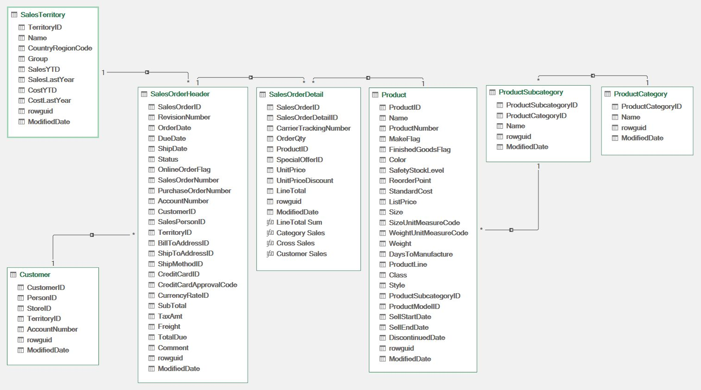

# Workbook Architecture

**Status: Implemented locally.** Seven source tables load into worksheets and the Data Model; six relationships are active. Shipped sales, units, distinct orders, average order value, fixed-window RFM and the sales and customer dashboards have bounded local validation. See [model validation](validation/2026-11-06-model-relationships.md) and [dashboard validation](validation/2026-11-08-dashboards.md). These checks do not establish every filter interaction or publication readiness.

## Data flow

```text
Official AdventureWorks OLTP sources (unchanged)
    ↓
Power Query: seven source loads
    ├──→ worksheet tables ──→ validation controls
    └──→ Excel Data Model: seven tables and six relationships
             ↓
         measures and PivotTables
             ↓
         sales and customer dashboards, category/territory analysis, scenario

Power Query: KeyChecks and SourceChecks ──→ key and source validation controls
```

## Logical model

The selected **sales fact grain** is one `SalesOrderDetail` line, with order-header attributes from `SalesOrderHeader`. Do not sum header-level totals after repeating them across detail rows.

The following screenshot shows the local Power Pivot model on 2026-11-06. The named sales calculations in that historical image were created for validation; the later shipped measures are documented in the [KPI catalog](KPI_CATALOG.md).



| Entity | Key/grain | Role |
| --- | --- | --- |
| Sales fact | `SalesOrderID` + `SalesOrderDetailID` | Amounts, units, product and order linkage |
| Order header | `SalesOrderID` | Order date, customer, territory, order type and status |
| Product | `ProductID` | Attributes, subcategory and category hierarchy |
| Customer | `CustomerID` | Person/store customer behavior and segmentation |
| Territory | `TerritoryID` | Geographic commercial analysis |
| Order date | `SalesOrderHeader.OrderDate` | Monthly sales and date filtering; no separate date table is claimed |
| Scenario inputs | Worksheet inputs | Assumptions, not actual sales |

The selected source's keys and joins were checked locally; initial workbook relationships and category/territory filters were also checked. See the [Source Map](SOURCE_MAP.md) and [model validation](validation/2026-11-06-model-relationships.md).

## Rules that prevent wrong analytics

1. Preserve original data and record its version / source.
2. Explicitly check types, currencies, missing keys and date ranges.
3. Confirm joins do not multiply sales lines or financial totals.
4. Define the sales measure, its exclusions and discount treatment before charting.
5. **Do not claim historical gross margin** until applicable historic costs have been validated; current product cost may not represent past cost.
6. Differentiate observed sales from assumed changes in scenario sheets.
7. Avoid importing unrelated manufacturing, purchasing and HR modules by default.

## Workbook presentation

- `DashboardSales`: shipped sales metrics, monthly trend, category and territory comparisons.
- `DashboardCustomers`: descriptive fixed-window RFM segments and distributions.
- `SalesScenario`: fixed-volume price and discount assumptions.
- `SalesByDate`, `CustomerRFM` and `RFMGuide`: analytical detail and scoring rules.
- `Validation` and `KeyChecks`: reconciliation and source/key controls.
- `DashboardData`, `SourceConfig` and seven source sheets: dashboard support, refresh configuration and loaded data.

`SalesOverview`, `SalesMonthly` and `CustomerOverview` are hidden, retained views with dependencies used by the dashboards and controls. The workbook has 20 sheets, 17 visible. Category and territory comparisons are part of the sales dashboard; no separate product dashboard or order-type filter is claimed.

## Tool boundary

Excel MCP has created and refreshed Power Query loads, model relationships and validation PivotTables in the local workbook. Direct DAX/DMV evaluation encountered an unregistered provider. [AI Workflow](AI_WORKFLOW.md) describes the tested operations, their limits and the Excel Desktop fallback.

Use Jira to track work items, not as the location of SQL, M code, business rules or authoritative calculation definitions. See [Jira Workflow](JIRA_WORKFLOW.md). GitHub holds versioned documents and deliverables.
